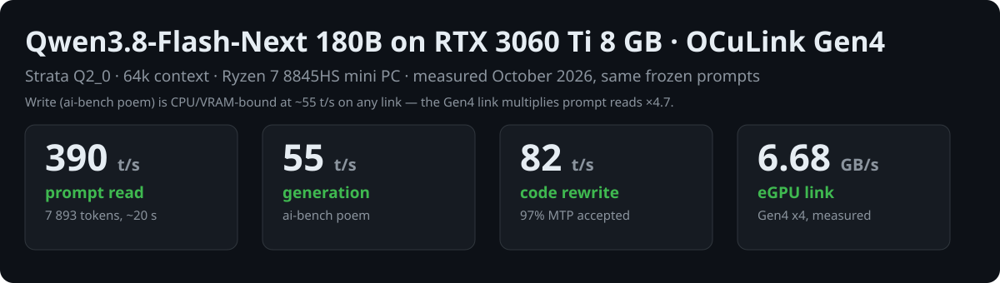
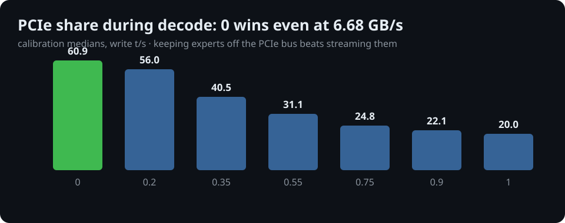
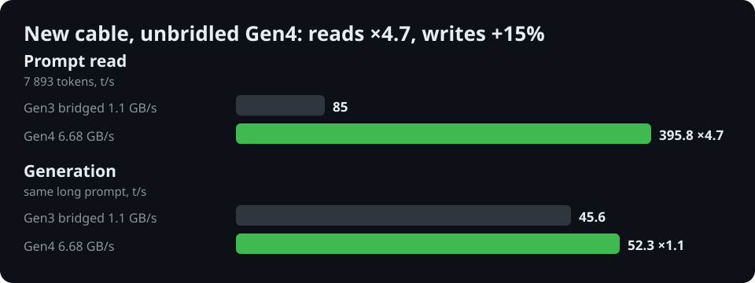

# Qwen3.8-Flash-Next 180B (Strata) on RTX 3060 Ti 8 GB over OCuLink



Dated speed measurements and the full working config for **Qwen3.8-Flash-Next 180B (~6B active)**
run with [Strata](https://github.com/Niko1221/Strata) on a mini PC whose only strong GPU is an
**RTX 3060 Ti 8 GB attached over OCuLink (PCIe Gen4 x4)**. Same machine and method as the sister repo
[emoubarak/minipc-egpu-llm](https://github.com/emoubarak/minipc-egpu-llm) (llama.cpp, 26–35B MoE);
this repo is Strata-only.

All numbers below are measured on this machine with the frozen prompts in `bench/`. Nothing is estimated.
Dates are in the filenames under `results/`.

## Hardware

| Part | Detail |
|---|---|
| PC | Minisforum EliteMini, Ryzen 7 8845HS (8C/16T), 64 GB DDR5 (60.6 GiB seen by Linux) |
| eGPU | RTX 3060 Ti 8 GB in an OCuLink dock, PCIe **Gen4 x4**, measured 6.68 GB/s host→device (`cudaMemcpy`, 48 MiB blocks) |
| CPU governor | `performance`, boost on (only remaining knob: BIOS PPT limit, untouched) |
| RAM used by Strata | ~41–45 GiB experts + VRAM (stop memory-hungry neighbours before starting) |

## Software

| Part | Version |
|---|---|
| OS | Fedora 44 Workstation, kernel 7.2.9 |
| NVIDIA driver / CUDA | 615.78 / CUDA 13.4 (engine built with it) |
| Python | 3.14 (Strata venv) |
| Strata engine | commit `7695859a` (reports 0.1.43), CUDA backend built from source |

## Model files (~66 GB)

| File | Source |
|---|---|
| `Qwen3.8-Flash-Next-GSQ-RCO-Q2_0-00001/2-of-00002.gguf` (37.6 + 28.8 GB) | [ISTA-DASLab/Qwen3.8-Flash-Next-GSQ-RCO-GGUF](https://huggingface.co/ISTA-DASLab/Qwen3.8-Flash-Next-GSQ-RCO-GGUF), `Q2_0` subfolder, revision `ed59f92` (2026-09-29) |
| MTP draft head (`mtp/rt/`, 0.9 GB) | downloaded by Strata `setup.py` for the Q2_0 pack |
| Pack + tokenizer (`packs/q2_0/`) | idem |
| Refusal direction (480 KB, optional abliteration) | [alesha-pro/Qwen3.8-Flash-Next-abliterated-GSQ-RCO-Strata-GGUF](https://huggingface.co/alesha-pro/Qwen3.8-Flash-Next-abliterated-GSQ-RCO-Strata-GGUF) |

`setup.py --model qwen3.8-flash-next --family q2_0` fetches weights + MTP + pack. The refusal
direction is subtracted from the residual stream at layers 4–44 (`--cvec-mode project`, see config):
same speed (42.8 t/s poem before/after), answers lock-picking questions again.

## Retained config

`config/strata-q2_0.template.json` (replace `$HOME`). Set by `./setup.sh --calibrate` on this machine
(~35 min) plus the sweeps below. Serve with:

```sh
cd ~/repos/other/strata
export STRATA_PREFILL_CPU_SHARE=1   # REQUIRED, see trap #1
.venv/bin/python serve/server.py --engine strata --config strata-q2_0.json --port 18090
```

| Setting | Value | Why |
|---|---|---|
| `--max-context` | 65536 | 32k→64k costs ~6% write, doubles the window; 128k refused (503, 98 MiB VRAM free) |
| `--kv` | int8 | |
| `--prefill` | auto (→ 2048) | auto already picks the max the VRAM allows; explicit 4096/8192 get clamped to 2048 |
| `--spec 4 --spec-min-p 0.5` + MTP head | speculative decoding on | 0.5 beats 0.3 (57.6) and 0.7 (62.5) at 63.2 t/s calibration |
| `--pcie-frac 0` | no expert streaming over PCIe during decode | 60.9 vs 56.0 (0.2) / 40.5 (0.35) / … / 20.0 (1.0): even at 6.68 GB/s, PCIe copies lose |
| `--pool-workers 4` | | 2→54.1, 4→58.2, 5→55.1, 7→59.0 (single shots); re-benched 7 flat at 4 |
| `--adapt-every 1 --adapt-swaps 160 --adapt-decay 0.97` | adaptive expert cache | 67.8 vs 66.3 (swaps 80) vs 62.3 (default) on the calibration test |
| `--expert-cache auto` | 839 slots @64k (1212 @32k) | |
| `fit_max_tokens: true` | shrink `max_tokens` instead of refusing oversized requests | |


| cvec | refusal direction removed, layers 4–44 | |

## Speed (Gen4 link, 64k, retained config)

Frozen prompts: `bench/prompt-benchmark.md` (Strata DETAILS.md excerpt, 7 893 tokens) and the
ai-bench poem. `wall` includes HTTP overhead; `pp`/`tg` come from the engine log.

| Test | Prompt read | Generation | Drafts accepted |
|---|---|---:|---|
| Poem x3 | — | 52–55 t/s | ~45–60% |
| Long prompt 7 893 tok | **~390 t/s** (~20 s) | 52–55 t/s | |
| Code rewrite 931 tok | ~209 t/s | **82 t/s**, faithful | 658/676 (**97%**) |

History: on the Gen3-bridged link (1.1 GB/s) the same config read at 85 t/s and wrote 37–55 t/s
(v0.1.41 wrote only 19–23 t/s). The Gen4 link multiplies reads ×4.7 and
barely moves writes (+7%) — decode is CPU/VRAM-bound, not PCIe-bound, which is why `--pcie-frac 0`
still wins at 6.68 GB/s.



## Variants tested, all rejected

Also tried, no measurable effect, config unchanged: `--pool-workers` 7, `--adapt-swaps` 320,
`--spec-min-p` 0.6, explicit `--prefill` 4096/8192 (clamped to 2048 by VRAM), `--lookup-chain` 2
(MTP already accepts 97% on rewrites), `--pool-workers` 8/15, `STRATA_PREFILL_CPU_SHARE=0.7`,
`--batch 2`, THP `always`, expert profile on code. Obsolete: `perf-ryzen` branch, v0.1.41 runs.
4–5× slower, kept for reference: Strata on the 780M iGPU (HIP build, 10 t/s write).
Raw runs: `results/` (reference only; the full sweep log lives in the author's lab notebook).

## Quality (same weights)

| Test | Score |
|---|---|
| MATH-500, 20 hardest (level 5), greedy, no thinking | **16/20** (Qwen3.6-35B Q4: 13/20 same day) |
| HumanEval, first 40 | 39/40 |
| In-house 20-decision agentic exam | 18/20 (same as Qwen3.6-35B, but ~22 s/decision: it re-reads multi-k-token prompts) |

## Reproduce

```sh
git clone https://github.com/Niko1221/Strata ~/repos/other/strata
cd ~/repos/other/strata && git checkout 7695859a
./setup.sh --model qwen3.8-flash-next --family q2_0   # ~66 GB download + CUDA build
./setup.sh --calibrate --yes                          # ~35 min, verifies the table above on YOUR link
# copy config/strata-q2_0.template.json -> strata-q2_0.json (replace $HOME), then serve (see above)
python3 bench/bench_strata.py 18090 /path/to/engine.log mylabel
python3 bench/bench_lookup.py 18090 /path/to/engine.log mylabel
```

Needs ~46 GiB free RAM and the RTX free. First start takes minutes (38 GB expert load).

## Traps

1. **`STRATA_PREFILL_CPU_SHARE=1` is load-bearing.** Without it the engine picks prefill chunk 512
   instead of 2048 (264 borrowed cache slots vs 701, same 839 slots / 420 MiB free) and long reads
   drop to ~140 t/s. Files `*-chunk512.json` show the trap, not their flags.
2. Check `prompt chunk auto:` in the engine log after every start: `2048 tokens` = healthy baseline,
   `512` = broken env. All numbers here are chunk-2048.
3. VRAM ceiling: 9+ expert layers on the RTX = `cudaMalloc failed` (7605/8192 MiB used at 6 layers).
4. 128k context refuses in 503 (`the GPU is in use by another program`): 213 cache slots, 98 MiB free.
5. `nvidia-smi` disagrees with the kernel driver after an update without reboot (NVML mismatch):
   reboot before trusting GPU monitoring (CUDA itself keeps working).

## License

MIT. Benchmark prompt excerpt (`bench/prompt-benchmark.md`) is from Strata's DETAILS.md
([Niko1221/Strata](https://github.com/Niko1221/Strata), MIT).
